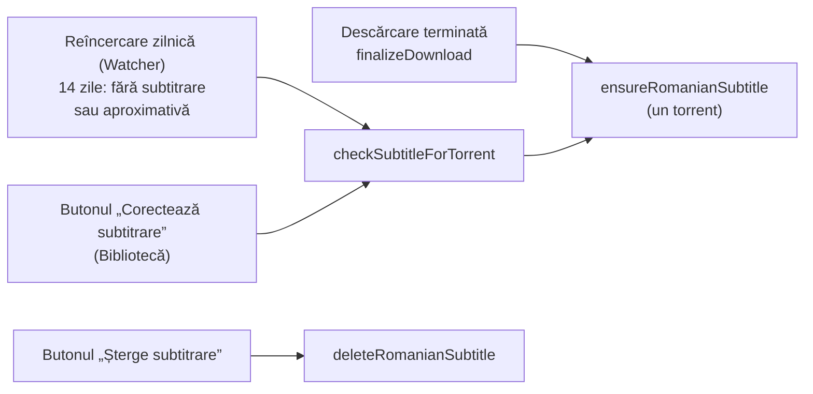
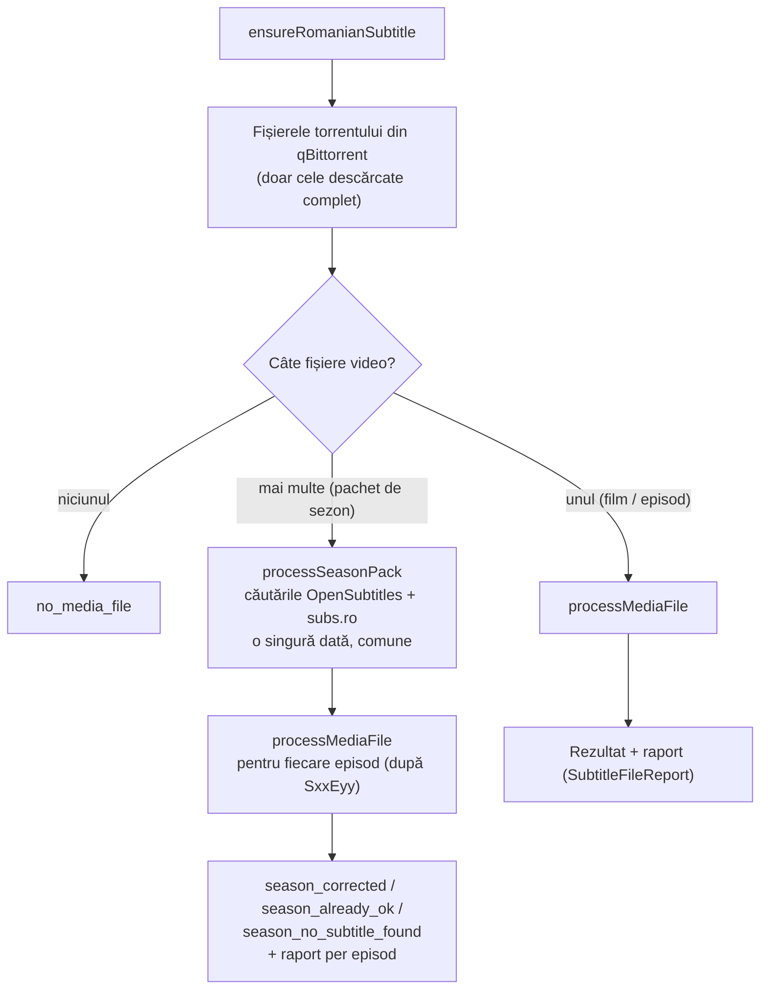
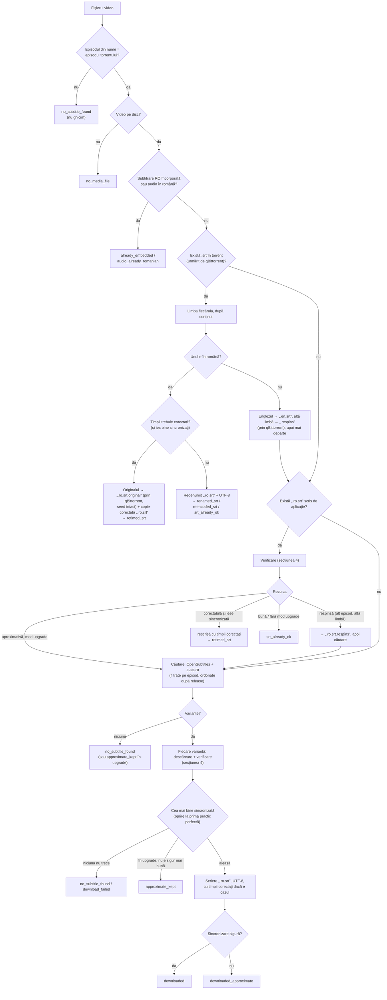
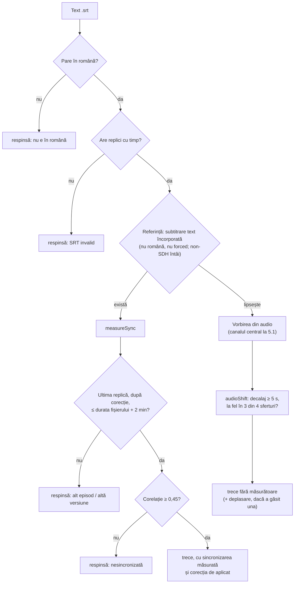
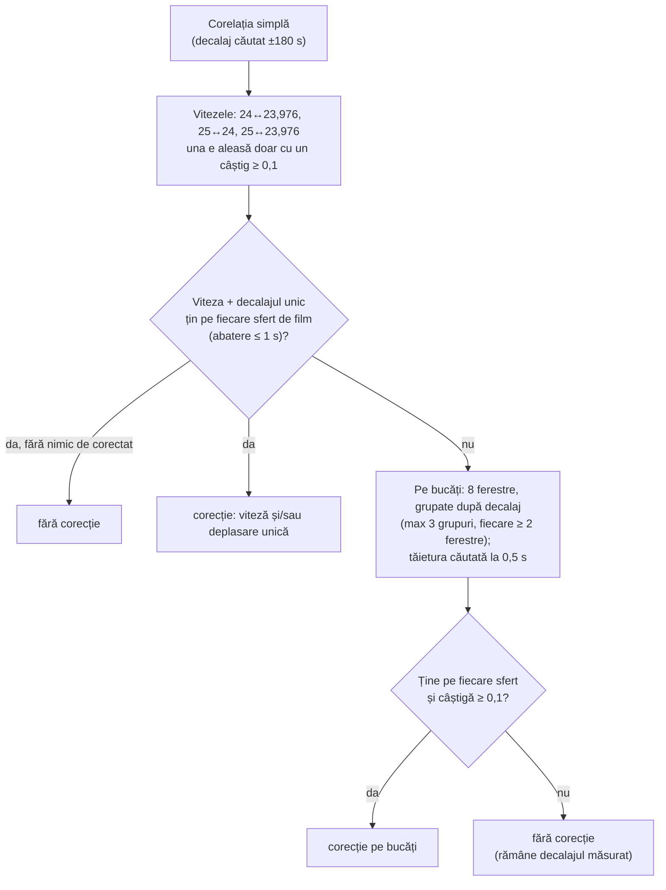
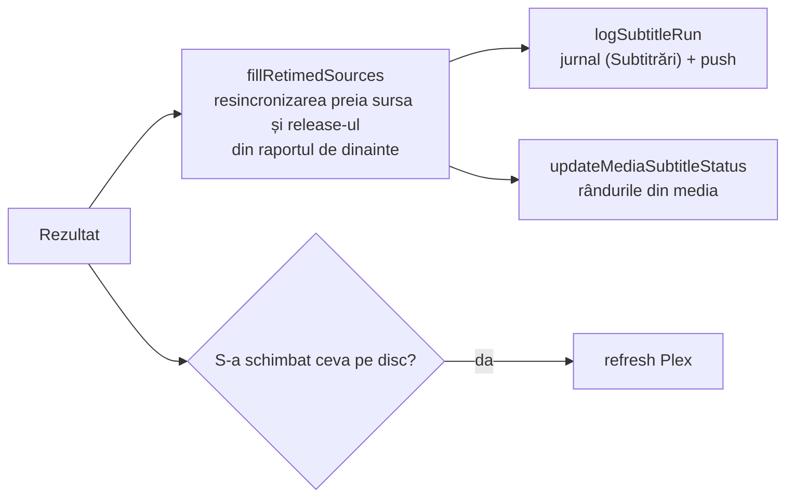

# Subtitrarea română — cum funcționează modulul

Tot ce face aplicația ca un titlu să aibă subtitrare română bună: căutare,
alegere, verificarea sincronizării, corectarea timpilor, scriere, stare în DB
și afișare. Codul e în `src/lib/filelist/subtitle*.ts` și `subtitles.ts`.

- [1. Când rulează](#1-când-rulează)
- [2. Fluxul pe un torrent](#2-fluxul-pe-un-torrent)
- [3. Fluxul pe un fișier video](#3-fluxul-pe-un-fișier-video)
- [4. Verificarea unei subtitrări](#4-verificarea-unei-subtitrări)
- [5. Rezultatele posibile](#5-rezultatele-posibile)
- [6. După verificare: jurnal, DB, Plex](#6-după-verificare-jurnal-db-plex)
- [7. Fișierele de pe disc](#7-fișierele-de-pe-disc)
- [8. Unde se vede](#8-unde-se-vede)
- [9. Fișierele modulului](#9-fișierele-modulului)

---

## 1. Când rulează

| Punct de intrare        | Ce caută                                                                          | Jurnal / push                                   |
| ----------------------- | --------------------------------------------------------------------------------- | ----------------------------------------------- |
| Finalul descărcării     | tot                                                                               | jurnal mereu; push doar dacă s-a schimbat ceva  |
| Reîncercarea zilnică    | doar torrentele fără subtitrare sau cu una aproximativă, 14 zile de la descărcare | doar când pune sau resincronizează o subtitrare |
| „Corectează subtitrare” | la fel ca reîncercarea, oricând (și după cele 14 zile)                            | jurnal mereu; toast cu rezultatul               |
| „Șterge subtitrare”     | —                                                                                 | toast cu fișierele șterse / puse deoparte       |

La o subtitrare **aproximativă**, reîncercarea și butonul rulează în modul
„upgrade”: o înlocuiesc doar cu una **sigur mai bună**, altfel rămâne
(`approximate_kept`).

---

## 2. Fluxul pe un torrent

---

## 3. Fluxul pe un fișier video

`processMediaFile` (`subtitle-pipeline.ts`). Se oprește la primul pas care
decide.

**Căutarea** (`subtitles.ts`, `subtitle-sources.ts`, `release-scoring.ts`):

- **OpenSubtitles** după IMDb, până la 5 pagini. Uploaderul `os-auto`
  (traduceri automate) e ignorat. În modul upgrade se iau doar variantele cu
  release identic, din cauza limitei de 20 de descărcări pe zi.
- **subs.ro** după IMDb, până la 6 arhive; la seriale întâi arhivele sezonului.
  Traducătorul „Ai” e ignorat. Fiecare fișier din arhivă e o variantă.
- **Episodul** se citește din `S01E03` sau `1x03`. La seriale se păstrează doar
  variantele episodului exact.
- **Ordinea** e după cât se potrivește numele release-ului cu al fișierului
  (sursa și grupul contează mult, rezoluția puțin; la egalitate, subs.ro).

---

## 4. Verificarea unei subtitrări

`createSubtitleVerifier` (`subtitle-verify.ts`) — un verificator per fișier
video. Durata, referința și analiza audio se citesc o singură dată.

### measureSync — sincronizarea și corecția timpilor

Subtitrarea și referința devin felii de 0,5 s „se vorbește / nu”. Corelația
Pearson la cel mai bun decalaj constant spune cât de bine se potrivesc (1 =
aceleași momente, ~0 = fără legătură).

După corecție decalajul rămas e 0, iar corelația e cea de după corecție.

| Prag                                   | Valoare                  | Rol                                                    |
| -------------------------------------- | ------------------------ | ------------------------------------------------------ |
| Corelație minimă                       | 0,45                     | sub ea: alt episod sau alt montaj, respinsă            |
| Bine sincronizată                      | ≥ 0,6 și decalaj ≤ 0,5 s | „sigură”, se oprește căutarea                          |
| Sigură și cu release identic           | decalaj ≤ 0,5 s          | traducătorii care unesc replicile ies sub 0,6          |
| Decalaj căutat                         | ±180 s                   | ediții cu intro mai lung (Amazon: 60–95 s)             |
| Verificare pe sferturi                 | abatere ≤ 1 s            | un alt montaj nu are decalaj constant                  |
| Câștig minim pentru viteză / pe bucăți | +0,1                     | sub asta e zgomot                                      |
| Audio: decalaj minim                   | 5 s                      | precizia audio e ~1 s la decalaje mari, ~2,5 s la mici |

**Audio** nu respinge nimic și nu face o subtitrare „verificată”: corelațiile
cu vorbirea din audio sunt mici (0,15–0,45 pentru varianta corectă). Folosit
doar pentru deplasări mari, unde o eroare de ~1 s e tot o îmbunătățire.

---

## 5. Rezultatele posibile

`SubtitleOutcome` (`subtitle-outcomes.ts`). Titlul și culoarea vin dintr-un
singur loc (`subtitleHeadline`, `subtitleOutcomeTone`), folosit de jurnal,
panoul tehnic, Bibliotecă și toast.

| Rezultat                   | Înseamnă                                                 | Ton      | Push la descărcare |
| -------------------------- | -------------------------------------------------------- | -------- | ------------------ |
| `downloaded`               | descărcată, sincronizare sigură                          | verde    | da                 |
| `downloaded_approximate`   | descărcată, de verificat                                 | galben   | da                 |
| `retimed_srt`              | subtitrarea existentă / din torrent, cu timpii corectați | verde    | da                 |
| `renamed_srt`              | `.srt` din torrent redenumit `.ro.srt`                   | verde    | da                 |
| `reencoded_srt`            | `.srt` din torrent convertit la UTF-8                    | verde    | da                 |
| `srt_already_ok`           | avea deja `.srt` bun                                     | neutru   | nu                 |
| `approximate_kept`         | aproximativa rămâne, nimic sigur mai bun                 | galben   | nu                 |
| `already_embedded`         | subtitrare RO încorporată                                | neutru   | nu                 |
| `audio_already_romanian`   | audio în română                                          | neutru   | nu                 |
| `no_subtitle_found`        | nimic găsit / toate variantele respinse                  | roșu     | da                 |
| `download_failed`          | eroare la descărcare sau scriere                         | roșu     | da                 |
| `no_media_file`, `no_imdb` | fără video pe disc / fără IMDb id                        | roșu     | da                 |
| `season_*`                 | agregatul unui pachet, cu raport per episod              | după caz | după caz           |

---

## 6. După verificare: jurnal, DB, Plex

Coloanele din `media`:

| Coloană                 | Ce ține                                                                                             |
| ----------------------- | --------------------------------------------------------------------------------------------------- |
| `has_romanian_subtitle` | are subtitrare română (orice rezultat bun)                                                          |
| `subtitle_source`       | `subsro`, `opensubtitles`, `tracked_srt`, `embedded`, `audio_ro`, `season_aggregate`                |
| `subtitle_detail`       | detaliul text, ca în jurnal                                                                         |
| `subtitle_report`       | raportul structurat (varianta aleasă, sincronizarea, corecția, variantele respinse) — pentru drawer |
| `subtitle_approximate`  | 1 = de verificat; reîncercarea o caută zilnic, 14 zile                                              |
| `subtitle_checked_at`   | ceasul reîncercării                                                                                 |

Reguli de scriere:

- `srt_already_ok`, `approximate_kept`, `season_already_ok` nu rescriu nimic
  în afară de dată — altfel un „Corectează” ar fi șters sursa reală.
- `retimed_srt` păstrează sursa; marcajul „aproximativă” devine 0, cu o
  excepție: o corecție făcută doar după audio îl lasă cum era.
- La pachete, fiecare episod primește rezultatul și raportul lui.

---

## 7. Fișierele de pe disc

Lângă `Film {imdb-tt…}.mkv`:

| Fișier                   | Al cui                | Înseamnă                                                                    |
| ------------------------ | --------------------- | --------------------------------------------------------------------------- |
| `Film {imdb-tt…}.ro.srt` | aplicație sau torrent | subtitrarea folosită de Plex                                                |
| `….ro.srt.original`      | torrent               | originalul din torrent, înlocuit de o copie corectată; seedat în continuare |
| `….ro.srt.sters`         | torrent               | scos de „Șterge subtitrare”; seedat în continuare                           |
| `….ro.srt.respins`       | aplicație/torrent     | respinsă (alt episod, altă limbă); păstrată doar pentru ștergerea titlului  |
| `….en.srt`               | torrent               | engleza din torrent, marcată ca Plex să n-o ia implicită                    |

Reguli:

- **Fișierele din torrent nu se modifică și nu se șterg niciodată** — doar se
  redenumesc prin API-ul qBittorrent, ca seed-ul să continue.
- „Corectează” refolosește un `.original` doar dacă lipsește copia.
- „Șterge subtitrare” șterge copiile aplicației și redenumește ce e al
  torrentului în `.sters`; după ea, „Corectează” face o căutare curată.
- Ștergerea titlului curăță tot, inclusiv `.respins`, `.original`, `.sters`
  (`disk-cleanup.ts`).
- Plex ignoră orice fișier care nu se termină în `.srt`.

---

## 8. Unde se vede

| Loc                                       | Ce arată                                                                                                                                                                                                                      |
| ----------------------------------------- | ----------------------------------------------------------------------------------------------------------------------------------------------------------------------------------------------------------------------------- |
| Bibliotecă → fișa titlului                | insignă „Subtitrare RO” / „Subtitrare aproximativă” / „Doar engleză”; rândul „Se caută zilnic…” sau „Căutarea s-a încheiat…”; în Detalii tehnice, raportul (sursă, release, sincronizare, timpi corectați, variante respinse) |
| Bibliotecă → butoane                      | „Corectează subtitrare” (toast cu rezultatul), „Șterge subtitrare”                                                                                                                                                            |
| Tehnic → Jurnal → Subtitrări              | o intrare per rulare; click → panoul cu raportul per fișier / episod                                                                                                                                                          |
| Tehnic → Watcher → Reîncercare subtitrări | istoricul rulărilor; „În căutare acum”, „Căutare încheiată, fără rezultat”, „…tot aproximativă”, „Găsite de reîncercare”                                                                                                      |
| Notificări push                           | „💬 Corecție Subtitrare”, după regulile din secțiunea 5                                                                                                                                                                       |

---

## 9. Fișierele modulului

| Fișier                    | Rol                                                                                               |
| ------------------------- | ------------------------------------------------------------------------------------------------- |
| `subtitles.ts`            | `ensureRomanianSubtitle` (torrent → fișiere), pachete, `deleteRomanianSubtitle`, `logSubtitleRun` |
| `subtitle-pipeline.ts`    | `processMediaFile` — deciziile pe un fișier video (secțiunea 3)                                   |
| `subtitle-checks.ts`      | verificări doar de citire: încorporate, audio RO, limba unui `.srt`, episodul din nume            |
| `subtitle-sources.ts`     | ordonarea variantelor după release                                                                |
| `release-scoring.ts`      | potrivirea numelor de release                                                                     |
| `subtitle-verify.ts`      | verificarea conținutului, `measureSync`, corecția timpilor, referința audio                       |
| `subtitle-apply.ts`       | singurele scrieri: redenumiri prin qBittorrent, scrierea variantei alese                          |
| `subtitle-encoding.ts`    | detectare/conversie UTF-8, scriere cu reîncercări                                                 |
| `subtitle-outcomes.ts`    | tipuri, rezultate, etichete comune (importabil și din client)                                     |
| `subtitle-retry.ts`       | reîncercarea zilnică și starea ei pentru Bibliotecă / Watcher                                     |
| `opensubtitles-client.ts` | client OpenSubtitles (cache Cloudflare ocolit cu `_`)                                             |
| `subsro-client.ts`        | client subs.ro, arhive zip/rar                                                                    |
| `download.ts`             | `checkSubtitleForTorrent`, butonul (`correctSubtitleForMediaCore`), finalul descărcării           |
| `../media/media.ts`       | `updateMediaSubtitleStatus`, `fillRetimedSources`, starea episoadelor din pachete                 |
| `disk-cleanup.ts`         | curățarea subtitrărilor la ștergerea titlului                                                     |
